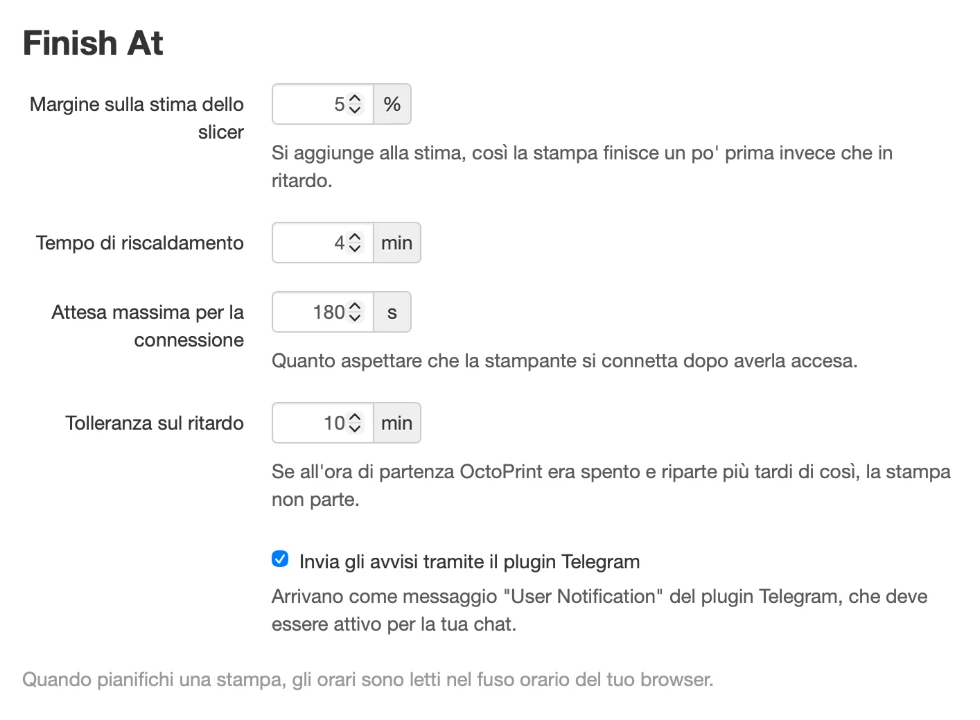

# OctoPrint-FinishAt

An [OctoPrint](https://octoprint.org) plugin that starts a print **so that it finishes at the time you choose**.

Pick a file, type "16:00", and Finish At works out when to start:

- it reads the **slicer's estimate** from the G-code (PrusaSlicer, SuperSlicer, OrcaSlicer, Cura); if there is none it uses OctoPrint's own analysis;
- it adds a **safety margin** (5% by default) and the **heat-up time** (4 minutes by default);
- at start time it **powers the printer on** through [PSU Control](https://plugins.octoprint.org/plugins/psucontrol/) if installed (so it works with any smart plug or relay PSU Control supports), waits for the printer to connect, and **starts the print**.

<!-- TODO screenshot: extras/screenshot.png -->

## Safety

- To schedule a print you must confirm that **the bed is clear and clean**.
- If, at start time, the printer is already printing, does not connect, or the file is gone, the print **does not start** and you are told why.
- If OctoPrint was down at the planned start and comes back more than 10 minutes late, the print **does not start late**.
- The schedule is saved in OctoPrint's settings, so it survives restarts.
- Only users allowed to print can schedule or cancel.

## Notifications

Results show up as OctoPrint notifications. If the [Telegram plugin](https://github.com/jacopotediosi/OctoPrint-Telegram)
is installed, they are also sent there through its "User Notification" message, which must be enabled for your chat.
The print start and finish are announced by Telegram itself, as usual.

## Installation

In OctoPrint: **Settings → Plugin Manager → Get More → … from URL**, and paste:

```
https://github.com/Ale6699/OctoPrint-FinishAt/archive/main.zip
```

Restart OctoPrint when asked. A **Finish At** tab appears next to the others.

## Settings

**Settings → Finish At**:

| Setting | Default | |
|---|---|---|
| Margin on the slicer estimate | 5% | Added to the estimate so the print finishes a little early rather than late |
| Heat-up time | 4 min | Nozzle and bed heat-up before the first layer |
| Printer connection timeout | 180 s | How long to wait for the printer to connect after powering on |
| Late start tolerance | 10 min | Later than this, a missed start is skipped |
| Telegram notifications | on | Only if the Telegram plugin is installed |

Times are read in your **browser's time zone** when you schedule, so it works even if OctoPrint's host
(for example a Docker container) runs in UTC.

## Languages

English and Italian, following the language of your browser or of OctoPrint. Translations are welcome:
see `translations_src/build_it.py` for how the Italian catalog is built.



*The settings page in Italian.*

## Development

The scheduling maths lives in `octoprint_finishat/planning.py` and can be tested without OctoPrint:

```bash
python3 -m unittest discover -s tests
```

## License

[AGPL-3.0-or-later](LICENSE), like OctoPrint.
